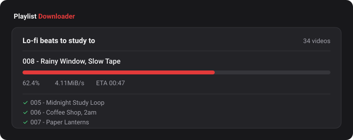

# YouTube Playlist Downloader

Download a whole YouTube playlist as MP4 video, or as MP3s with cover art.
One file to double-click, nothing to install. Windows 10 and 11.

About page: **https://playlist-downloader-eight.vercel.app**

## Get started

1. **Get the file.** One button on
   [the site](https://playlist-downloader-eight.vercel.app), or from
   [the latest release](https://github.com/Poasherkir/Playlist/releases/latest),
   or clone this repo.
2. **Copy the playlist link** from your browser's address bar.
3. **Double-click `Download Playlist.bat`.** A black window opens, the
   downloader opens in your browser, and after a five-second countdown it
   starts on the link you copied.

That's the whole thing. The first run needs a few extra minutes to fetch its
tools; after that it goes straight to the page.

The file works on its own, so the one from the site is all you need. Run it and
it pulls down the rest beside itself, and at every start it checks for a newer
version of the rest, so fixes reach you without downloading it again. Next to a
cloned repo it just runs what is already there and never overwrites it.

## Using it

Copy a link before you start it and the downloader picks it up by itself. The
countdown has a Cancel button, in case that link was copied long ago.

Or paste anywhere on the page and it begins. You don't have to click into the
box first, and there is nothing to confirm. Paste several links at once, or
another while one is running, and they queue up, each in its own folder.

Format and folder sit on that same screen, and both are remembered for next
time. Three formats:

- **Video** (the default): MP4 in H.264 with AAC sound, up to 1080p. It plays on
  any Windows 10 or 11 PC as it is, in Films & TV, Media Player, VLC or a TV.
- **Video, best quality**: up to 4K. Above 1080p YouTube only offers VP9 and AV1,
  and Windows 10 needs Microsoft's free AV1 Video Extension from the Store to
  play AV1.
- **Music**: MP3 with the thumbnail as cover art and proper track titles.

Leave the folder empty and each playlist gets its own folder in Downloads,
named after the playlist.

While it runs you get "Video 7 of 42", how far through the whole playlist it
is, roughly how long is left, and a list of every video marked waiting,
downloading, joining, done, failed or already there. When a playlist is done
Windows shows a notification and the tab title says so. **Open folder** takes
you straight there.

**The black window is the downloader.** Closing it stops everything. The page is
only the controls, so you can close and reopen the tab freely, or return to the
address printed in that window. Double-click the file again while it is
running and the link goes to the window already open instead of starting a
second one.

**A shortcut from YouTube.** At the foot of the page is a **Download playlist**
link. Drag it to your browser's bookmarks bar. On any YouTube page, with the
black window open, click it and that page's playlist starts downloading.

## Good to know

- **You can stop it any time.** Press Stop, or close the black window. Come back
  later, pick the same folder, and it carries on where it left off; a video cut
  off halfway resumes from where it stopped.
- **Finished videos are only counted once they have been checked.** Each one is
  opened with ffprobe, and only a file with both picture and sound (or, for an
  MP3, sound) is written to `already-downloaded.mp4.txt` or
  `already-downloaded.mp3.txt` in that folder. That is how it knows what to
  skip. Video and music keep separate lists, so you can download a playlist as
  both into one folder. Delete a list to download everything again. The single
  `already-downloaded.txt` from version 1.0 is still read for video.
- **Failures are explained, one by one.** A private, removed, region-locked or
  age-restricted video is skipped rather than stopping the run, and listed at
  the end with the reason. Anything that might work a second time (a dropped
  connection, YouTube refusing a request) is tried once more after a short
  pause, and **Retry failed videos** tries again whenever you like.
- Every video arrives as one MP4 with picture and sound together. YouTube
  sends the two separately, so they are fetched and joined in a hidden
  `.incomplete` folder, and only the finished file is put in yours. Anything
  cut short waits in there to be resumed.
- Files are numbered `001 - Title.mp4` so they keep playlist order.
- A `watch?v=...&list=...` link downloads the whole playlist, not just the one
  video you were watching.
- Nothing is installed. The tools live in a `bin` folder next to the script
  (about 150 MB), nothing touches your PATH or registry, and deleting that
  folder removes every trace. yt-dlp, which does the downloading, updates
  itself at every start.
- The page is served only to your own machine, on localhost. Nobody else can
  reach it, and other websites cannot start or stop anything through it.

## If something goes wrong

**A download manager grabs the video instead.** IDM and similar tools hook into
your browser and take anything that looks like a media file. This downloader
runs outside the browser, so they cannot see its downloads. They will still grab
the video if a YouTube page opens in the browser itself, which is what happens
when the link goes into the address bar, so paste it on the downloader's page
instead. To stop IDM doing it at all, open IDM, go to Options, then General, and
switch off integration for your browser.

You don't need IDM to get picture and sound in one file. YouTube sends them as
two streams to everyone, IDM included. IDM joins them behind the scenes, and
so does this.

**Older downloads came out as two files, picture in one and sound in the
other.** Version 1.0 did that when ffmpeg failed to start, leaving names like
`001 - Title.f137.mp4` and `001 - Title.f140.m4a`. Run the same playlist into
that folder again: the page offers **Repair split videos**, which joins each
pair into one MP4, checks it, and only then deletes the halves. A half that
cannot be joined is struck off the list of finished videos, so **Retry**
downloads it whole.

**"ffmpeg will not run".** It is checked at every start, because without it
picture and sound cannot be joined. This is usually antivirus holding back
`bin\ffmpeg.exe`. Allow it, delete the `bin` folder and run again.

**YouTube blocked the request, or "confirm you're not a bot".** Nearly always
yt-dlp being behind a change on YouTube's side. It updates itself at every
start, but if several videos in a playlist are blocked anyway, the page offers
**Fix: update the downloader engine**. That switches yt-dlp to its nightly build,
which usually has the fix days before a normal release, and tries the blocked
videos again. It never does that without you asking.

**Age-restricted videos.** These need a signed-in account. If you want them,
export your YouTube cookies to a file named `cookies.txt` (a browser extension
such as "Get cookies.txt LOCALLY" does this) and put it next to
`playlist.ps1`. It is used when present and ignored otherwise. Treat that file
like a password and delete it when you are done.

**The page doesn't open.** The black window prints the address, normally
`http://localhost:8730/`. Open it by hand. If that port is busy the script
moves up until it finds a free one, so the number may differ.

## Updating from 1.0

If you got the file from the site before version 1.1, download
`Download Playlist.bat` once more and replace the old one. The new one fetches
fresh copies of the rest at every start, so this is the last time. Clones of
this repo update with `git pull`.

## Why the website doesn't do the downloading

The page on Vercel describes the tool and links to it. It cannot download, and
neither could any hosted version:

- YouTube blocks datacenter IPs. Requests from Vercel, AWS and the like get the
  bot check almost immediately, while the same request from a home connection is
  fine.
- Serverless functions time out after 10 to 60 seconds and have no disk. A
  playlist is minutes of work and gigabytes of files.
- It would be against YouTube's terms and most hosts' acceptable use policies.

Running it on your own machine avoids all three, and you still get a real
interface instead of a console.

## What's in here

| | |
|---|---|
| `Download Playlist.bat` | What you double-click. On its own, fetches the rest and keeps it up to date. |
| `playlist.ps1` | Serves the page and drives yt-dlp. |
| `ui.html` | The page itself. |
| `site/` | The public page, deployed to Vercel, plus a copy of the launcher it hands out. |
| `bin/` | Tools, fetched on first run. Safe to delete. |

Built on [yt-dlp](https://github.com/yt-dlp/yt-dlp) and
[ffmpeg](https://ffmpeg.org), and released under the [MIT licence](LICENSE).
Download only what you have the right to download.
